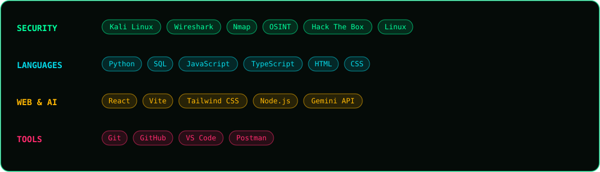
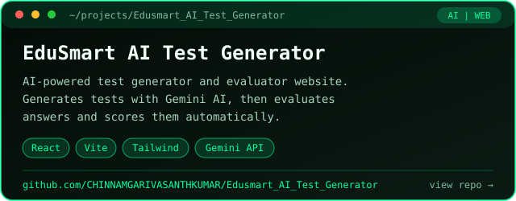
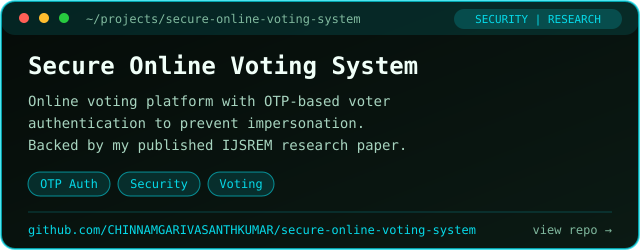
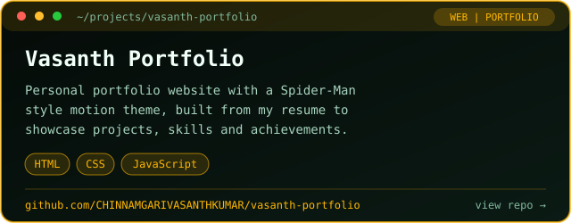
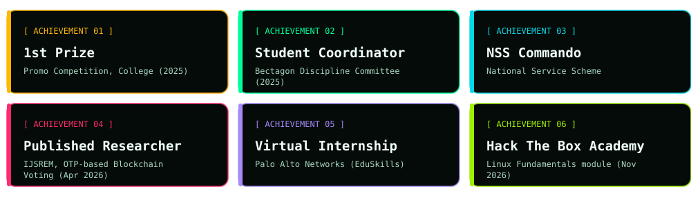

<div align="center">




</div>

---

## 👨‍💻 About Me

```python
class Vasanth:
    role       = "Cyber Security Graduate (B.Tech 2026, CGPA 7.6)"
    college    = "Bapatla Engineering College"
    location   = "Andhra Pradesh, India"
    published  = "OTP-based Authentication for Blockchain Voting (IJSREM, Apr 2026)"
    internship = "Palo Alto Networks (EduSkills) Virtual Internship"
    learning   = ["Hack The Box Academy", "DevSecOps", "AI + Security"]
    goal       = "Break things ethically, build secure things properly."
```

- 🔐 I analyse and secure systems: network analysis, scanning, OSINT and web security basics.
- 🧪 I build full-stack and AI projects, then think about how to attack and defend them.
- 🎯 **Looking for:** Cyber Security / Security Testing / SOC Analyst (entry-level) roles.

---

## 🛠️ Active Tech Stack

<div align="center">

</div>

---

## 🚀 Featured Projects

<div align="center">

<a href="https://github.com/CHINNAMGARIVASANTHKUMAR/Edusmart_AI_Test_Generator"></a>
<a href="https://github.com/CHINNAMGARIVASANTHKUMAR/secure-online-voting-system"></a>

<a href="https://github.com/CHINNAMGARIVASANTHKUMAR/vasanth-portfolio"></a>

</div>

### 📡 Live Repository Stats

<div align="center">


</div>

### 📥 Downloads

> Counts **GitHub Release** downloads. Publish a Release on a repo and its counter starts.

<div align="center">


</div>

---

## 🏆 Achievements

<div align="center">

</div>

---

## 📈 Contribution Graph

<div align="center">

</div>

---

## 📫 Let's Connect

<div align="center">

<a href="https://www.linkedin.com/in/YOUR-LINKEDIN/"></a>
<a href="mailto:YOUR-EMAIL@gmail.com"></a>
<a href="https://github.com/CHINNAMGARIVASANTHKUMAR/vasanth-portfolio"></a>

<br/><br/>

*"Hackers break things to learn. I learn to protect things."*

</div>
